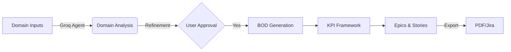

# Discovery Accelerator Pro - Application Architecture Guide

## Table of Contents
1. [Overview](#overview)
2. [Technology Stack](#technology-stack)
3. [System Architecture](#system-architecture)
4. [Service Layer Details](#service-layer-details)
5. [User Journeys & Flow Diagrams](#user-journeys--flow-diagrams)
6. [Key Features & Capabilities](#key-features--capabilities)
7. [Data Flow & Persistence](#data-flow--persistence)

---

## Overview

**Discovery Accelerator Pro** (aka PRSIM.AI Discovery) is an enterprise-grade product strategy platform designed to transform raw ideas into actionable engineering specifications. It employs a multi-agent AI system to guide users through a structured 4-stage discovery process:

1.  **Domain Analysis**: Market research, problem definition, and competitive landscape.
2.  **BOD (Business Opportunity Document)**: Operational workflows, entity modeling, and system design.
3.  **KPI Framework**: Success metrics, OKRs, and performance indicators.
4.  **Epics & Backlog**: Technical specifications, user stories, and acceptance criteria.

The platform distinguishes itself with **multimodal analysis** (processing text, images, video, PDFs), **real-time voice interaction**, **live web research**, and **seamless integration** with enterprise tools like Jira.

---

## Technology Stack

### Frontend Core
- **Framework**: React 19.2.x (TypeScript)
- **Build Tool**: Vite 6.2.x
- **Styling**: Tailwind CSS (Utility-first) + FontAwesome 6 (Icons)
- **State Management**: React Context + Hooks (`useState`, `useReducer`)

### AI & Intelligence
- **Primary Logic Engine**: Groq SDK (running `openai/gpt-oss-120b`)
- **Multimodal Engine**: Google GenAI SDK (`gemini-2.0-flash-exp` / `gemini-1.5-pro`)
- **Voice Intelligence**: Gemini 2.0 Flash (Primary STT) + Groq Whisper (Fallback STT) + Gemini Live (Real-time Audio)
- **Web Research**:
    - **Scraping**: `api.allorigins.win` (CORS Proxy) + Mozilla Readability
    - **Search**: Google Serper API (Real-time Grounding)

### Backend & Infrastructure
- **Hosting**: Firebase Hosting / Cloudflare Pages
- **Auth**: Firebase Authentication (Google Sign-In)
- **Database**: Firebase Firestore (User Configurations, persisted state)
- **Functions**: Cloud functions for secure API handling (optional)

### Key Libraries
- **Encoding**: `marked` (Markdown rendering), `dompurify` (Sanitization)
- **Utils**: `lucide-react` (UI Icons), `jspdf` (PDF Generation)
- **Integration**: `jira.js` (Atlassian Connectivity)

---

## System Architecture

The application implements a **Dual-Engine Hybrid Architecture**, allowing users to switch between **Google Gemini** and **Groq** (Llama/GPT-OSS) based on the task requirements (Speed vs. Reasoning).

### The Dispatcher Pattern
The Frontend Controller (`App.tsx`) acts as a central **Model Dispatcher**. When a user initiates an action:
1.  **State Check**: The system checks the `selectedModel` state (Default: `gemini-2.5-pro`).
2.  **Route Selection**:
    - If `groq-*` is selected -> Routes to `groqService.ts`.
    - If `gemini-*` is selected -> Routes to `geminiService.ts`.
3.  **Multimodal Handling**: If images/PDFs are present, the system *automatically* favors `geminiService` unless explicitly overridden, as it handles native multimodal tokens.

```mermaid
graph TB
    subgraph "Presentation Layer"
    GROQ --> SEARCH
    GEMINI --> SEARCH
    
    GROQ --> G_CLOUD
    VOICE --> G_CLOUD
    GEMINI --> M_CLOUD
    LIVE --> M_CLOUD
    SEARCH --> S_CLOUD
```

---

## Service Layer Details

### 1. `groqService.ts` (The Orchestrator)
- **Role**: Main text-generation engine for all 4 discovery stages.
- **Model**: `gpt-oss-120b` (via Groq) for high-speed reasoning.
- **Capabilities**:
    - Parses user input + file context.
    - Decides when to call `searchService` (Agentic Tool Use).
    - Formats output in strict Markdown.

### 2. `geminiService.ts` (The Visionary)
- **Role**: Handling interactions involving **Images**, **Videos**, or **PDFs**.
- **Model**: `gemini-1.5-pro` / `gemini-2.0-flash`.
- **Key Feature**: **Smart Query Extraction**.
    - If Native Grounding fails, it intelligently parses the prompt to extract the "Active User Input" and performs a fallback search via Serper to ensure relevance.

### 3. `searchService.ts` (The Researcher)
- **Role**: Fetching real-time market data.
- **Provider**: Google Serper API.
- **Logic**: Returns "Organic Results" and "Knowledge Graph" data, which are then injected into the LLM's system prompt (RAG - Retrieval Augmented Generation).

### 4. `jiraService.ts` (The Integrator)
- **Role**: Syncing generated Epics/Stories to Jira Cloud.
- **Flow**:
    - Authenticates via API Token.
    - Parses the "Epics" stage output (Markdown).
    - Creates `Epic` -> `Story` hierarchy in the target Jira Project.

---

## User Journeys & Flow Diagrams

### Journey 1: The Discovery Pipeline
Users move linearly from idea to specs.



### Journey 2: Context-Aware Search
How the system ensures search results are relevant (The "Audit Trail").

1. **Input**: User asks "Market size for FinTech app".
2. **Context Injection**: System appends `[Module: Market Analysis] [Company: Acme Inc]`.
3. **Smart Extraction**: `geminiService` extracts the clean query via Regex.
4. **Search**: query becomes `"Market size for FinTech app Acme Inc Market Analysis"`.
5. **Result**: Highly relevant links are returned and appended to the PDF export.

---

## Key Features & Capabilities

### 1. Collapsible Sidebar & Layout
- **Design**: Responsive grid layout (5/7 split on desktop).
- **Function**: Sidebar collapses to maximize the "Workbench" area for reading reports.
- **Controls**: Toggle button in header (Left) and floating expand button (Right).

### 2. PDF Export with Audit Trail
- **Feature**: Generates professional PDF reports.
- **Enhancement**: Automatically appends a verified **"Audit Trail & References"** section at the end of the document, listing all external URLs used by the AI during analysis.

### 3. AI Refinement Studio
- **Feature**: Users can "Refine" any section of the output.
- **Voice-Enabled**: Users can speak their refinement instructions ("Make this more professional").
- **Context-Aware**: The Voice Assistant knows *exactly* which text block is being edited.

### 4. Branding & Visual Identity
- **Theme**: "Discovery Pro" Dark Mode.
- **Identity**: Consistent branding (Layer Group Icon, "DISCOVERY PRO" typography) across Login, Sidebar, and Headers.

---

## Data Flow & Persistence

- **Session State**: All data (Inputs, Outputs, Chat History) is held in the React `state` tree (`AppState` interface).
- **Persistence**: Data is not currently auto-saved to backend DB (session-based), but **Architecture supports Firebase sync** (configured in `firebaseConfig.ts`).
- **File Handling**: Uploaded files are converted to Base64 in memory for immediate LLM processing; not stored permanently on server to ensure privacy.

---

*Verified & Updated: Jan 2026*
