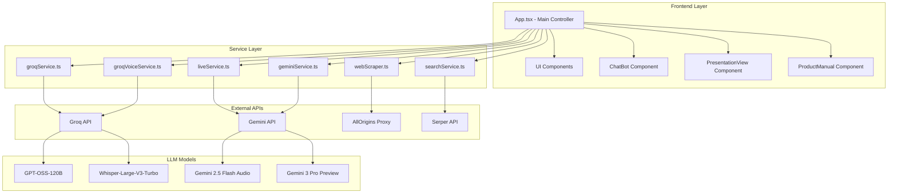
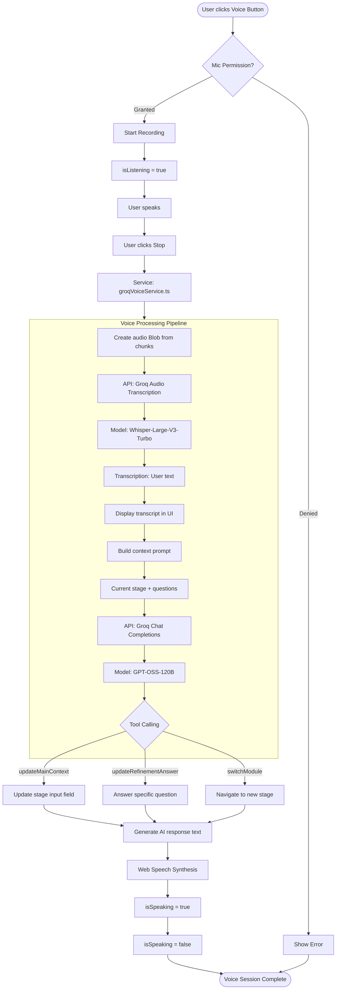
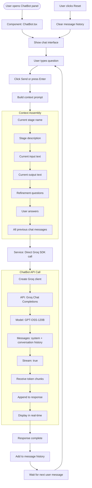
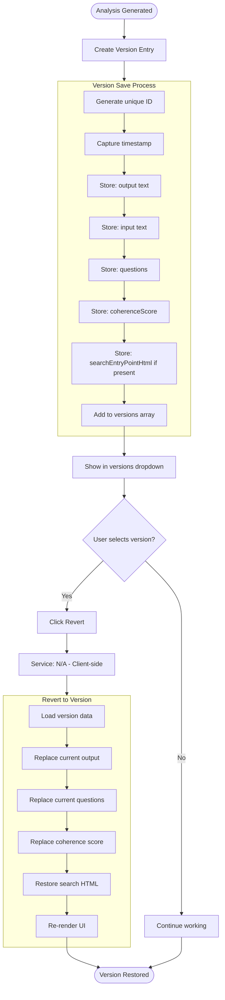

# Discovery Accelerator Pro - Application Architecture Guide

## Table of Contents
1. [Overview](#overview)
2. [Technology Stack](#technology-stack)
3. [System Architecture](#system-architecture)
4. [Service Layer Details](#service-layer-details)
5. [User Journeys & Flow Diagrams](#user-journeys--flow-diagrams)
6. [API & LLM Integration Points](#api--llm-integration-points)

---

## Overview

**Discovery Accelerator Pro** (aka PRSIM.AI Discovery) is an enterprise product discovery platform that guides teams through a structured 4-stage product discovery process using AI-powered agents. The application transforms raw business ideas into executable engineering backlogs through intelligent analysis, multi-agent orchestration, and multimodal interactions.

### Core Capabilities
- **4-Stage Discovery Pipeline**: Domain → BOD → KPI → Epics
- **Multi-Agent AI System**: Specialized agents for each discovery stage
- **Multimodal Input**: Text, Voice, Files (PDF/Images/Video), URLs
- **Live Voice Assistance**: Real-time conversational AI with Gemini 2.5 Flash
- **Assistant Chatbot**: Context-aware Q&A using Groq GPT-OSS-120B
- **Web Research**: Automated web scraping and Google Search integration
- **Export Capabilities**: Markdown, Web, PDF formats

---

## Technology Stack

### Frontend
- **Framework**: React 19.2.3 (TypeScript)
- **Build Tool**: Vite 6.2.0
- **UI Components**: Custom components with FontAwesome icons
- **Markdown**: `marked` library for rendering
- **Sanitization**: DOMPurify for HTML sanitization

### Backend Services
- **Deployment**: Cloudflare Pages/Workers
- **Config**: wrangler.jsonc

### AI/LLM Providers
- **Groq**: Primary LLM provider (GPT-OSS-120B, OpenAI models)
- **Google Gemini**: Multimodal & Live API (Gemini 2.5/3 Flash/Pro Preview)
- **Speech-to-Text**: Whisper-Large-V3-Turbo (via Groq)

### External APIs
- **Web Scraping**: AllOrigins proxy (api.allorigins.win)
- **Content Parsing**: Mozilla Readability
- **Search**: Google Serper API (optional)

### Data Storage
- **State Management**: React useState (in-memory)
- **Persistence**: Browser LocalStorage/SessionStorage (implicit)
- **Export**: Client-side file generation

---

## System Architecture



### Architecture Layers

#### 1. Presentation Layer (`App.tsx`)
- **State Management**: Manages `AppState` containing all 4 stages, metadata, and UI state
- **User Interactions**: Handles input changes, file uploads, URL additions, stage navigation
- **Orchestration**: Coordinates service calls and updates UI based on responses
- **Export Logic**: Generates Markdown/Web/PDF exports

#### 2. Component Layer
- **ChatBot**: Standalone AI assistant for contextual Q&A
- **PresentationView**: Export preview and presentation mode
- **ProductManual**: User guide and documentation
- **MarkdownRenderer**: Renders AI-generated markdown content

#### 3. Service Layer
Six specialized services handling different aspects of AI/data processing:

| Service | Purpose | Primary API | Models Used |
|---------|---------|-------------|-------------|
| `groqService.ts` | Main AI agent for discovery stages | Groq | GPT-OSS-120B |
| `geminiService.ts` | Multimodal analysis (images/video/PDFs) | Gemini | Gemini 3 Pro Preview |
| `groqVoiceService.ts` | Voice assistant (STT + AI + TTS) | Groq | Whisper + GPT-OSS-120B |
| `liveService.ts` | Real-time multimodal conversation | Gemini Live API | Gemini 2.5 Flash Audio |
| `webScraper.ts` | URL content extraction | AllOrigins | N/A |
| `searchService.ts` | Google search integration | Serper | N/A |

#### 4. External Integration Layer
- **Groq API**: Text generation, audio transcription, tool calling
- **Gemini API**: Multimodal generation, live audio, grounding/search
- **AllOrigins**: CORS-bypass web scraping
- **Serper**: Search results retrieval

---

## Service Layer Details

### 1. groqService.ts - Core Discovery Engine

**Purpose**: Powers the 4-stage discovery process with AI-generated analysis

**Key Function**: `callGroqAgent()`

**Parameters**:
- `modelName`: LLM model (mapped to GPT-OSS-120B)
- `systemInstruction`: Stage-specific system prompt
- `userPrompt`: Combined context (metadata + user input + files + URLs)
- `contextFiles`: Uploaded files (text content)
- `isThinking`: Whether to use extended thinking mode
- `useSearch`: Enable Google Search grounding

**LLM Models Used**:
- **Primary**: `openai/gpt-oss-120b` (standardized across all stages)
- **Search Mode**: Optionally calls `searchGoogle()` for external research

**Response Structure**:
```typescript
{
  text: string;                    // Main AI response
  sources?: GroundingSource[];     // Search result citations
  searchEntryPointHtml?: string;   // Search query info
}
```

**Features**:
- Token streaming with status updates
- Tool calling for search integration
- File context injection (text files)
- Multi-turn conversation history

---

### 2. geminiService.ts - Multimodal Analysis

**Purpose**: Handles images, videos, and PDFs for context-aware analysis

**Key Function**: `callGeminiAgent()`

**Multimodal Support**:
- Images: `image/*` (inline base64)
- Videos: `video/*` (inline base64)
- PDFs: `application/pdf` (inline base64)

**LLM Models Used**:
- **Multimodal/Thinking**: `gemini-3-pro-preview`
- **Search Mode**: `gemini-3-flash-preview` (fallback)

**Special Features**:
- **Thinking Mode**: Extended reasoning with `thinkingBudget: 32768` tokens
- **Google Search**: Built-in grounding with `tools: [{ googleSearch: {} }]`
- **Grounding Metadata**: Extracts search sources and entry points

**Use Cases**:
- Analyzing competitor product screenshots
- Processing business presentation PDFs
- Understanding demo videos
- Vision-based market research

---

### 3. groqVoiceService.ts - Voice Assistant

**Purpose**: Voice-controlled interface for hands-free project input

**Key Class**: `GroqVoiceAssistant`

**Workflow**:
```
User Speech → MediaRecorder → Whisper STT → GPT-OSS-120B → Tool Calling → TTS Response
```

**LLM Models Used**:
1. **Whisper-Large-V3-Turbo**: Speech-to-text transcription
2. **GPT-OSS-120B**: Intent understanding and tool selection

**Tool Calling Functions**:
- `updateMainContext(text, mode)`: Replace or append to stage input
- `updateRefinementAnswer(index, text)`: Answer specific questions
- `switchModule(module)`: Navigate to different stage

**State Management**:
- `isListening`: Recording user audio
- `isSpeaking`: Playing TTS response
- Callbacks for UI updates and transcription display

**Process Flow**:
1. Start recording via `navigator.mediaDevices.getUserMedia()`
2. Capture audio chunks in WebM format
3. Send to Whisper for transcription
4. Build context-aware prompt with current stage info
5. Call GPT-OSS-120B with tool definitions
6. Execute tool calls to update app state
7. Speak response using Web Speech Synthesis API

---

### 4. liveService.ts - Real-time Multimodal Assistant

**Purpose**: Real-time bidirectional voice conversation with native audio AI

**Key Function**: `createLiveAssistant()`

**LLM Model**: `gemini-2.5-flash-native-audio-preview-09-2025`

**Features**:
- **Native Audio I/O**: No STT/TTS needed, direct audio processing
- **Real-time Streaming**: Bidirectional WebSocket connection
- **Tool Calling**: Same tools as Groq voice assistant
- **Voice Config**: Uses "Zephyr" voice preset
- **Transcription**: Automatic input/output transcription

**Audio Processing**:
- **Input**: 16kHz PCM, streamed via ScriptProcessor
- **Output**: 24kHz PCM, decoded and played via Web Audio API
- **Interruption Handling**: Stops playback when user speaks

**Connection Lifecycle**:
1. Establish WebSocket to Gemini Live API
2. Request microphone permissions
3. Stream PCM audio chunks to API
4. Receive audio responses and tool calls
5. Play audio and execute tools
6. Handle interruptions and state changes

**Tool Integration**:
Same 3 tools as voice assistant integrated with Gemini's function calling

---

### 5. webScraper.ts - URL Content Extraction

**Purpose**: Fetch and parse web page content for contextual analysis

**Key Function**: `scrapeUrl(url)`

**Process**:
1. **Proxy Request**: Fetch via `api.allorigins.win` to bypass CORS
2. **HTML Sanitization**: Clean with DOMPurify
3. **Content Extraction**: Parse with Mozilla Readability
4. **Formatting**: Return structured text (URL + Title + Content)

**Output Format**:
```
URL: https://example.com
TITLE: Page Title

CONTENT:
[Main article text extracted by Readability]
```

**Fallback**: If Readability fails, extracts `doc.body.innerText`

**Error Handling**: Returns `[FAILED TO SCRAPE URL: ...]` on errors

---

### 6. searchService.ts - Google Search Integration

**Purpose**: Perform web searches to enrich AI context with real-time data

**Key Function**: `searchGoogle(query)`

**API**: Google Serper (`google.serper.dev`)

**Parameters**:
- Query string
- Number of results (default: 5)

**Response**:
```typescript
{
  text: string;                 // Concatenated snippets
  sources: GroundingSource[];   // [{title, uri}]
}
```

**Data Sources**:
- Organic search results (top 5)
- Knowledge Graph (if available)

**Integration**: Called by `groqService.ts` when `useSearch: true`

---

## User Journeys & Flow Diagrams

### Journey 1: Core Discovery Process (4-Stage Pipeline)

This is the primary user journey where teams progress through the structured discovery process.

#### Flow Diagram Structure



```mermaid
flowchart TD
    START([User Lands on App]) --> META[Fill Project Metadata]
    META --> STAGE1[Stage 1: DOMAIN]
    
    subgraph DOMAIN_STAGE ["🧭 DOMAIN - Strategy Orchestrator"]
        D1[User provides: Vision/Problem/Business Case]
        D2[Optional: Add URLs/Files]
        D3[Click 'Synthesize Domain']
        D4{Analysis Running}
        D5[Service: groqService.ts]
        D6[LLM: GPT-OSS-120B]
        D7[Process: Web Scraping if URLs]
        D8[Service: webScraper.ts]
        D9[Optional: Search Integration]
        D10[Service: searchService.ts]
        D11[Output Generated]
        D12[AI asks 3-5 Clarification Questions]
        D13[User answers questions]
        
        D1 --> D2
        D2 --> D3
        D3 --> D4
        D4 -->|Yes| D5
        D5 --> D6
        D6 --> D7
        D7 -->|URLs Present| D8
        D8 --> D9
        D9 -->|useSearch=true| D10
        D10 --> D11
        D7 -->|No URLs| D11
        D9 -->|useSearch=false| D11
        D11 --> D12
        D12 --> D13
    end
    
    STAGE1 --> DOMAIN_STAGE
    D13 --> STAGE2[Stage 2: BOD]
    
    subgraph BOD_STAGE ["📄 BOD - Business Architect"]
        B1[Previous context auto-imported]
        B2[User adds operational details]
        B3[Optional: Upload format reference file]
        B4[Click 'Draft BOD']
        B5[Service: groqService.ts]
        B6[LLM: GPT-OSS-120B]
        B7{Multimodal Context?}
        B8[Service: geminiService.ts]
        B9[LLM: Gemini 3 Pro Preview]
        B10[Output: BOD with entities & flows]
        B11[AI asks 3-5 Questions for KPI stage]
        B12[User answers]
        
        B1 --> B2
        B2 --> B3
        B3 --> B4
        B4 --> B7
        B7 -->|No Images/PDFs| B5
        B5 --> B6
        B6 --> B10
        B7 -->|Yes Images/PDFs| B8
        B8 --> B9
        B9 --> B10
        B10 --> B11
        B11 --> B12
    end
    
    STAGE2 --> BOD_STAGE
    B12 --> STAGE3[Stage 3: KPI]
    
    subgraph KPI_STAGE ["📊 KPI - Performance Analyst"]
        K1[Previous BOD + Domain imported]
        K2[User specifies goals/benchmarks]
        K3[Click 'Establish Metrics']
        K4[Service: groqService.ts]
        K5[LLM: GPT-OSS-120B]
        K6[Output: North Star + Leading/Lagging KPIs]
        K7[AI asks 3-5 Questions for Epics]
        K8[User answers]
        
        K1 --> K2
        K2 --> K3
        K3 --> K4
        K4 --> K5
        K5 --> K6
        K6 --> K7
        K7 --> K8
    end
    
    STAGE3 --> KPI_STAGE
    K8 --> STAGE4[Stage 4: EPICS]
    
    subgraph EPICS_STAGE ["✓ EPICS - TPM Backlog Agent"]
        E1[All previous context imported]
        E2[User adds tech constraints/capacity]
        E3[Click 'Generate Backlog']
        E4[Service: groqService.ts]
        E5[LLM: GPT-OSS-120B]
        E6[Output: Epics + User Stories + ACs]
        E7[AI asks final clarification questions]
        E8[User reviews/refines]
        E9[Export: Markdown/Web/PDF]
        
        E1 --> E2
        E2 --> E3
        E3 --> E4
        E4 --> E5
        E5 --> E6
        E6 --> E7
        E7 --> E8
        E8 --> E9
    end
    
    STAGE4 --> EPICS_STAGE
    E9 --> END([Discovery Complete])
```

#### API & LLM Triggers - Core Discovery

| User Action | Service Called | API/LLM | Model | Purpose |
|-------------|----------------|---------|-------|---------|
| Click "Synthesize Domain" | `groqService.ts` | Groq | GPT-OSS-120B | Generate domain analysis |
| URLs present in stage | `webScraper.ts` | AllOrigins | N/A | Fetch web content |
| Search enabled | `searchService.ts` | Serper | N/A | Get search results |
| Search results available | `groqService.ts` | Groq | GPT-OSS-120B | Integrate search into analysis |
| Images/PDFs uploaded | `geminiService.ts` | Gemini | Gemini 3 Pro Preview | Multimodal analysis |
| Click "Draft BOD" | `groqService.ts` | Groq | GPT-OSS-120B | Generate BOD document |
| Format reference file | `groqService.ts` | Groq | GPT-OSS-120B | Structure output per template |
| Click "Establish Metrics" | `groqService.ts` | Groq | GPT-OSS-120B | Generate KPI framework |
| Click "Generate Backlog" | `groqService.ts` | Groq | GPT-OSS-120B | Create epics & user stories |
| Re-analyze any stage | `groqService.ts` | Groq | GPT-OSS-120B | Regenerate with new context |
| Import previous stage | N/A | N/A | N/A | Client-side state copy |

---

### Journey 2: Voice Assistant Interaction

Voice-based interface for hands-free project input and navigation.

#### Flow Diagram Structure



#### API & LLM Triggers - Voice Assistant

| Event | Service | API | Model | Action |
|-------|---------|-----|-------|--------|
| User clicks voice button | `groqVoiceService.ts` | Browser MediaRecorder | N/A | Start recording |
| Recording stopped | `groqVoiceService.ts` | Groq Audio | Whisper-Large-V3-Turbo | Transcribe speech to text |
| Transcription complete | `groqVoiceService.ts` | Groq Chat | GPT-OSS-120B | Understand intent & select tool |
| Tool: updateMainContext | `App.tsx` | N/A | N/A | Update state.stages[currentStage].input |
| Tool: updateRefinementAnswer | `App.tsx` | N/A | N/A | Update state.stages[currentStage].answers[index] |
| Tool: switchModule | `App.tsx` | N/A | N/A | Navigate to different stage |
| AI response ready | `groqVoiceService.ts` | Web Speech API | N/A | Text-to-speech playback |

---

### Journey 3: Live Multimodal Assistant

Real-time voice conversation with native audio AI (Gemini 2.5 Flash).

#### Flow Diagram Structure



```mermaid
flowchart TD
    START([User toggles LIVE Voice - Green Button]) --> MODE{Check Current Mode}
    MODE -->|Groq Mode| SWITCH[Switch to Live Mode]
    MODE -->|Live Mode| INIT[Initialize Live Assistant]
    
    SWITCH --> INIT
    INIT --> CONN[Service: liveService.ts]
    
    subgraph LIVE_CONNECTION ["Gemini Live API Connection"]
        L1[Create GoogleGenAI client]
        L2[Model: gemini-2.5-flash-native-audio-preview]
        L3[Open WebSocket connection]
        L4[Request microphone permissions]
        L5[Create AudioContext 16kHz input]
        L6[Create ScriptProcessor for audio chunks]
        L7[isListening = true]
        
        L1 --> L2
        L2 --> L3
        L3 --> L4
        L4 --> L5
        L5 --> L6
        L6 --> L7
    end
    
    CONN --> LIVE_CONNECTION
    
    L7 --> STREAM[Stream PCM audio to API]
    
    subgraph BIDIRECTIONAL ["Real-time Bidirectional Audio"]
        S1[User speaks continuously]
        S2[Audio chunks sent every 4096 samples]
        S3[API processes in real-time]
        S4[Input transcription received]
        S5[Display user transcript]
        S6{Tool Call?}
        S7[Execute tool function]
        S8[Send tool response]
        S9[Native audio response received]
        S10[Output transcription received]
        S11[Display model transcript]
        S12[Decode PCM 24kHz]
        S13[Play audio via Web Audio API]
        S14[isSpeaking = true]
        S15{User interrupts?}
        S16[Stop all audio playback]
        S17[Clear audio queue]
        
        S1 --> S2
        S2 --> S3
        S3 --> S4
        S4 --> S5
        S5 --> S6
        S6 -->|Yes| S7
        S7 --> S8
        S8 --> S9
        S6 -->|No| S9
        S9 --> S10
        S10 --> S11
        S11 --> S12
        S12 --> S13
        S13 --> S14
        S14 --> S15
        S15 -->|Yes| S16
        S16 --> S17
        S17 --> S1
        S15 -->|No| S1
    end
    
    STREAM --> BIDIRECTIONAL
    
    S17 --> CLOSE{User stops?}
    CLOSE -->|Click Stop| CLEANUP[Close WebSocket]
    CLEANUP --> STOP_TRACKS[Stop media tracks]
    STOP_TRACKS --> CLOSE_AUDIO[Close AudioContexts]
    CLOSE_AUDIO --> END([Live Session Complete])
    
    CLOSE -->|No| S1
```

#### API & LLM Triggers - Live Multimodal

| Event | Service | API | Model | Action |
|-------|---------|-----|-------|--------|
| Toggle Live mode | `liveService.ts` | Gemini Live API | Gemini 2.5 Flash Audio | Open WebSocket connection |
| Audio chunk ready | `liveService.ts` | Gemini Live API | Gemini 2.5 Flash Audio | Stream PCM audio (16kHz) |
| Input transcription | `liveService.ts` | Gemini Live API | Built-in ASR | Display user speech |
| Tool call received | `App.tsx` | N/A | N/A | Execute updateMainContext/updateRefinementAnswer/switchModule |
| Tool response sent | `liveService.ts` | Gemini Live API | Gemini 2.5 Flash Audio | Continue conversation |
| Audio response received | `liveService.ts` | Web Audio API | N/A | Decode and play PCM (24kHz) |
| Output transcription | `liveService.ts` | Gemini Live API | Built-in TTS | Display model speech |
| User interrupts | `liveService.ts` | Web Audio API | N/A | Stop playback, clear queue |
| Stop button clicked | `liveService.ts` | Gemini Live API | N/A | Close WebSocket |

---

### Journey 4: ChatBot Assistant

Context-aware Q&A assistant for help and guidance during discovery.

#### Flow Diagram Structure



#### API & LLM Triggers - ChatBot

| Event | Service | API | Model | Action |
|-------|---------|-----|-------|--------|
| User sends message | `ChatBot.tsx` | Groq Chat | GPT-OSS-120B | Generate contextual response |
| Token received | `ChatBot.tsx` | Groq Chat (streaming) | GPT-OSS-120B | Append and display incrementally |
| Response complete | `ChatBot.tsx` | N/A | N/A | Save to message history |
| User clicks Reset | `ChatBot.tsx` | N/A | N/A | Clear conversation history |

---

### Journey 5: Multi-Version Management

Track and revert to previous analysis versions for each stage.

#### Flow Diagram Structure



#### Version Management Actions

| Action | Service | API | Model | Purpose |
|--------|---------|-----|-------|---------|
| Analysis complete | `App.tsx` | N/A | N/A | Auto-create version snapshot |
| Calculate coherence | `App.tsx` | N/A | N/A | Score based on completeness metrics |
| Select version | `App.tsx` | N/A | N/A | Display version details |
| Revert to version | `App.tsx` | N/A | N/A | Restore all version data to current |

---

## API & LLM Integration Points

### Complete Integration Matrix

| Integration Point | Trigger | Service | External API | LLM Model | Input | Output |
|-------------------|---------|---------|--------------|-----------|-------|--------|
| **Stage Analysis** | Run Analysis button | `groqService.ts` | Groq Chat API | GPT-OSS-120B | System prompt + user context + files + URLs | Stage output + questions |
| **Web Scraping** | URLs present in stage | `webScraper.ts` | AllOrigins | N/A | URL string | Extracted text content |
| **Google Search** | useSearch=true | `searchService.ts` | Serper | N/A | Query string | Snippets + sources |
| **Multimodal Analysis** | Images/PDFs uploaded | `geminiService.ts` | Gemini API | Gemini 3 Pro Preview | Base64 media + text | Analysis + grounding |
| **Voice Transcription** | Voice recording stopped | `groqVoiceService.ts` | Groq Audio API | Whisper-Large-V3-Turbo | Audio blob (WebM) | Transcribed text |
| **Voice Intent** | Transcription complete | `groqVoiceService.ts` | Groq Chat API | GPT-OSS-120B | Transcript + context + tools | Tool call + response |
| **Voice TTS** | AI response ready | `groqVoiceService.ts` | Web Speech API | Browser TTS | Response text | Spoken audio |
| **Live Audio In** | Microphone active | `liveService.ts` | Gemini Live API | Gemini 2.5 Flash Audio | PCM stream (16kHz) | Transcription + audio response |
| **Live Audio Out** | Model response | `liveService.ts` | Gemini Live API | Gemini 2.5 Flash Audio | Tool responses | PCM audio (24kHz) + transcription |
| **ChatBot Q&A** | User sends message | `ChatBot.tsx` | Groq Chat API | GPT-OSS-120B | Message + context | Streamed response |
| **Export MD** | Export Markdown | `App.tsx` | N/A | N/A | All stage outputs | .md file download |
| **Export Web** | Export Web | `App.tsx` | N/A | N/A | All stage outputs | .html file download |
| **Export PDF** | Export PDF | `App.tsx` | Browser print | N/A | HTML export | PDF via print dialog |

### Environment Variables Required

```bash
# Groq API Key (for GPT-OSS-120B and Whisper)
GROQ_API_KEY=gsk_...

# Gemini API Key (for Gemini 3 Pro/Flash and Live API)
API_KEY=AIza...

# Serper API Key (optional, for Google Search)
SERPER_API_KEY=...
```

### Model Selection Logic

#### groqService.ts
- **Default**: `openai/gpt-oss-120b`
- **All Stages**: Same model for consistency

#### geminiService.ts
- **Multimodal/Thinking**: `gemini-3-pro-preview`
- **Search/Fast**: `gemini-3-flash-preview` (fallback)

#### groqVoiceService.ts
- **STT**: `whisper-large-v3-turbo`
- **Intent/Response**: `openai/gpt-oss-120b`

#### liveService.ts
- **Live Audio**: `gemini-2.5-flash-native-audio-preview-09-2025`

#### ChatBot.tsx
- **Direct Groq**: `openai/gpt-oss-120b`

---

## Data Flow Summary

### Primary Data Pipeline

```
Project Metadata → Stage Input → Context Assembly → AI Service → LLM → Response → Parse Questions → User Answers → Next Stage
```

### Context Assembly Strategy

For each analysis, the context includes:

1. **Project Metadata** (8 fields: company, mission, vertical, geography, TAM, revenue, websites, competitors)
2. **Stage Configuration** (Title, system instruction, agent name)
3. **User Input** (Main text area content)
4. **Previous Stages** (Outputs from completed earlier stages)
5. **Uploaded Files** (Text content or base64 for media)
6. **Scraped URLs** (Extracted web content)
7. **Search Results** (If search enabled)
8. **Refinement Answers** (User responses to AI questions)
9. **Format Reference** (Optional template file)

### State Management

**AppState Structure**:
```typescript
{
  currentStage: DiscoveryStage;           // DOMAIN | BOD | KPI | EPICS
  projectMetadata: ProjectMetadata;       // 8 key fields
  stages: {
    [DiscoveryStage.DOMAIN]: StageData,
    [DiscoveryStage.BOD]: StageData,
    [DiscoveryStage.KPI]: StageData,
    [DiscoveryStage.EPICS]: StageData
  }
}
```

**StageData Structure**:
```typescript
{
  input: string;                          // User's main input
  output: string;                         // AI-generated analysis
  files: FileContext[];                   // Uploaded files
  urls: string[];                         // Reference URLs
  formatReference?: FileContext;          // Optional template
  status: 'pending' | 'completed' | 'error';
  questions: string[];                    // AI-generated questions
  answers: Record<string, string>;        // User's answers
  groundingSources?: GroundingSource[];   // Search citations
  searchEntryPointHtml?: string;          // Search query info
  versions: StageVersion[];               // Version history
  coherenceScore: number;                 // Quality metric (0-100)
}
```

---

## Key Features & Workflows

### 1. Coherence Scoring
- **Trigger**: After each analysis
- **Logic**: Calculates 0-100 score based on:
  - Output length (20%)
  - Has questions (20%)
  - Has answers (20%)
  - Has grounding sources (20%)
  - Has previous context (20%)

### 2. Import Previous Stage
- **Trigger**: User clicks "Import Previous Stage Output"
- **Action**: Appends previous stage's output to current input
- **Purpose**: Maintain continuity and context across stages

### 3. Format Reference Files
- **Trigger**: User uploads reference document
- **Action**: Injects template into system prompt
- **Purpose**: Enforce specific output formatting/structure

### 4. Version History
- **Trigger**: Each successful analysis
- **Storage**: In-memory array per stage
- **Actions**: View, revert, compare versions

### 5. Multi-Language Export
- **Markdown**: Raw text with markdown formatting
- **Web**: Standalone HTML with embedded styles
- **PDF**: Browser print dialog from HTML export

---

## Security & Configuration

### CORS Handling
- **Strategy**: AllOrigins proxy for web scraping
- **Proxy URL**: `https://api.allorigins.win/get?url=...`
- **Limitation**: Public proxy, rate-limited

### API Key Management
- **Client-Side**: Exposed via `process.env` (Vite environment variables)
- **Risk**: API keys visible in browser (development mode)
- **Production**: Should use Cloudflare Workers with server-side secrets

### Deployment
- **Platform**: Cloudflare Pages
- **Build**: `npm run build` → `dist/`
- **Config**: `wrangler.jsonc` defines asset directory
- **Environment**: Set `GROQ_API_KEY`, `API_KEY`, `SERPER_API_KEY` in Cloudflare dashboard

---

## Flow Diagram Summary

This document provides the **complete architecture breakdown** with **5 detailed user journeys**:

1. **Core Discovery Process**: 4-stage pipeline with conditional multimodal/search
2. **Voice Assistant**: STT → Intent → Tool Calling → TTS
3. **Live Multimodal**: Real-time bidirectional audio with Gemini 2.5 Flash
4. **ChatBot Assistant**: Context-aware Q&A with conversation history
5. **Version Management**: Track, compare, and revert stage outputs

Each journey includes:
- Detailed flow diagram in Mermaid format
- Complete API/LLM trigger matrix
- Service-level integration points
- Input/output specifications

**Use these diagrams to create visual flowcharts in tools like Mermaid Live Editor, draw.io, or Lucidchart.**
